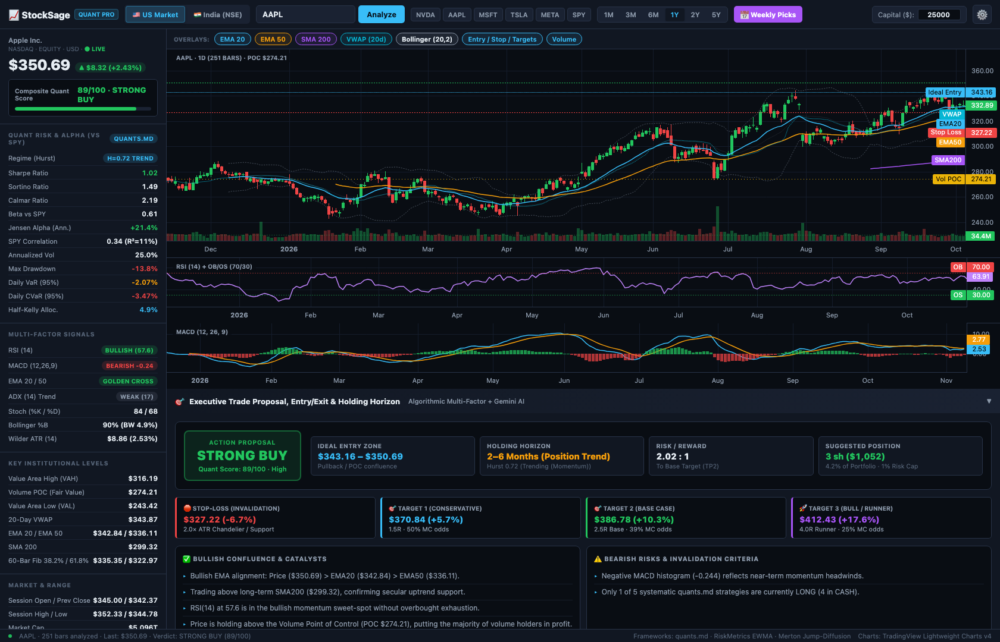
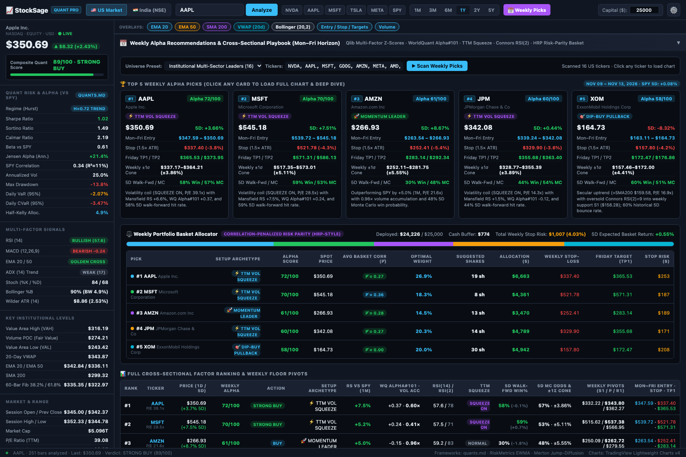
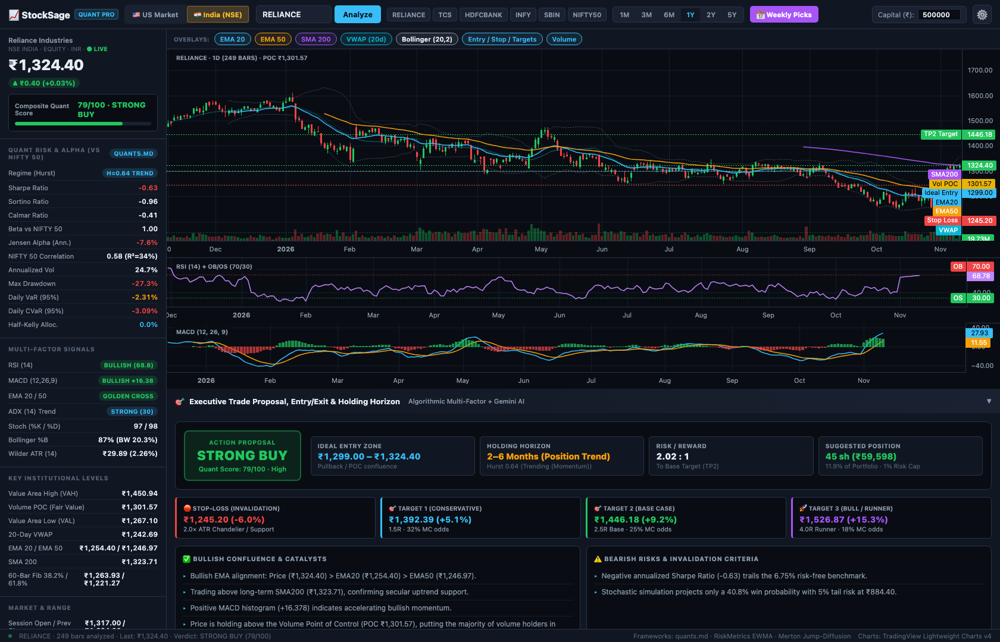
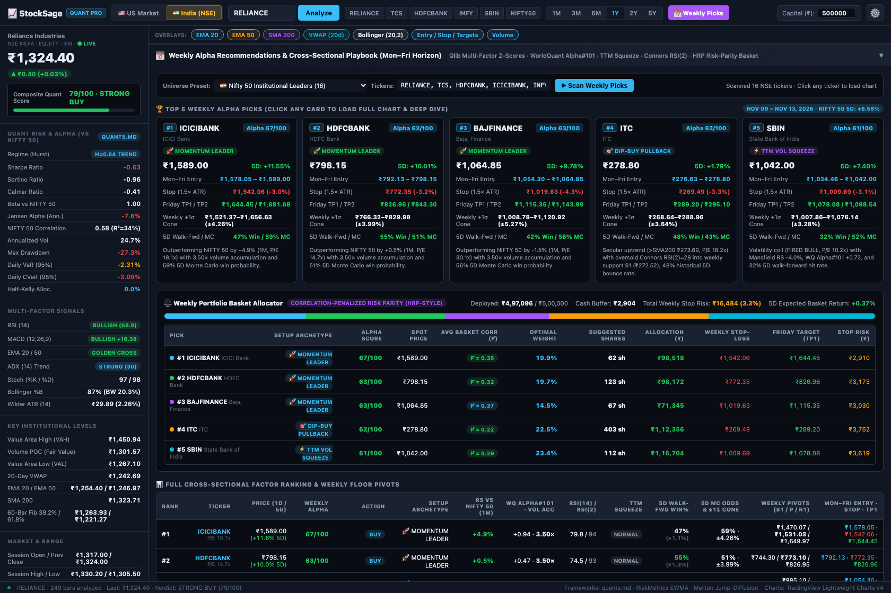
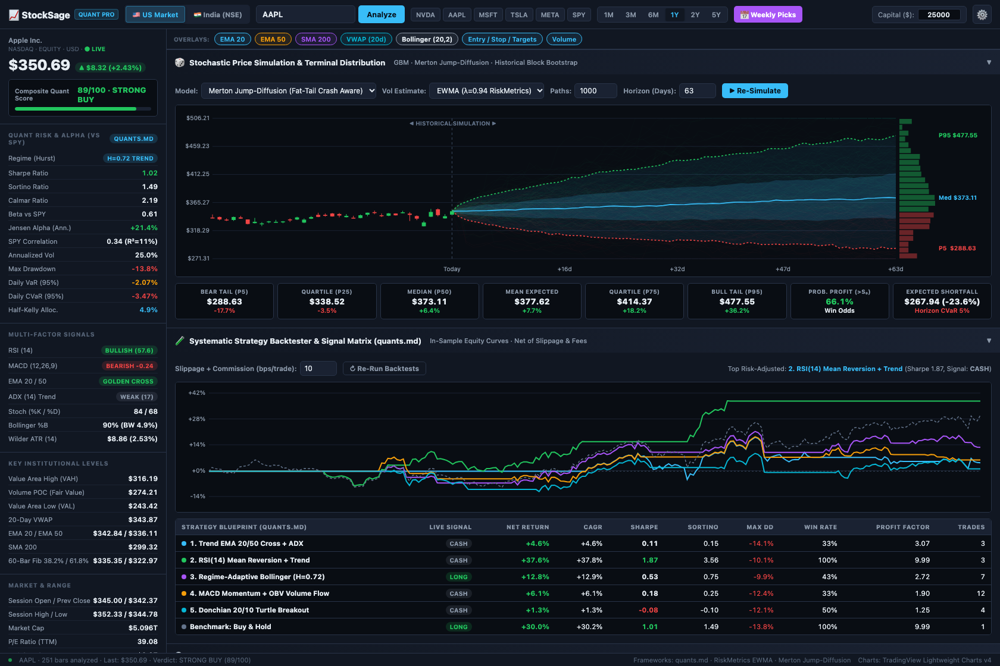
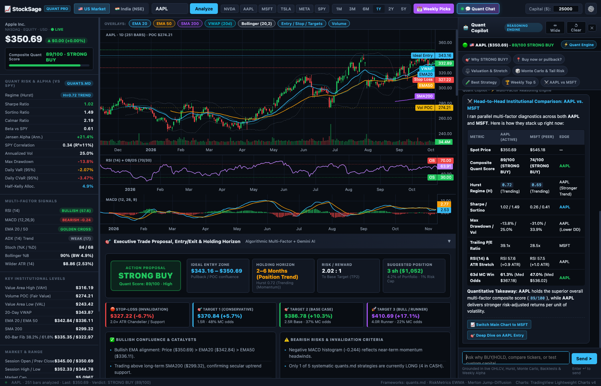

# StockSage Quant Pro 📈

Institutional-grade quantitative stock analysis web application, Weekly Alpha Recommendations & Cross-Sectional Scanner (`Qlib` / `WorldQuant Alpha#101` / `HRP Risk-Parity`), stochastic Monte Carlo simulation suite, `quants.md` systematic strategy backtester, and CLI research engine supporting both **🇺🇸 US Equities (NASDAQ/NYSE in `$` USD)** and **🇮🇳 Indian Equities (NSE/BSE in `₹` INR)**.

---

## ✨ Interface Showcase

### 1. 🇺🇸 US Market Institutional Quant Dashboard (`NASDAQ / NYSE`)
Multi-pane TradingView Lightweight Charts v4 with OHLCV candlesticks, EMA 20/50, SMA 200, 20-Day VWAP, Bollinger Bands (20,2), Volume Point of Control (`POC`), dynamic Entry/Stop/Target overlays, RSI (14), MACD (12,26,9), real-time Quant Risk & Alpha telemetry (`Hurst Exponent`, `Sharpe`, `Sortino`, `Calmar`, `Jensen's Alpha`, `VaR 95%`, `CVaR 95%`, `Half-Kelly`), and an automated **Executive Trade Proposal**.



---

### 2. 🎯 Weekly Alpha Recommendations & Cross-Sectional Playbook (`Mon–Fri Horizon`)
Parallel multi-sector scanner ranking universes via **Cross-Sectional Z-Scores (`Qlib` style)** across **Mansfield Relative Strength**, **WorldQuant Formulaic Alpha #101**, **TTM Volatility Squeeze**, **Connors RSI(2)**, **5-Day Merton Jump-Diffusion Monte Carlo**, **Rolling 5-Day Walk-Forward Hit Rate**, **Weekly Floor Pivots (`S1 / P / R1`)**, and a **Valuation (`P/E`) & Short-Term Overextension (`ATR Stretch`) Guardrail**—complete with a **Correlation-Penalized Risk-Parity (`HRP`) Portfolio Basket Allocator**.



---

### 3. 🇮🇳 India (`NSE / BSE`) Parallel Market Analysis (`₹ INR`)
One-click **`🇺🇸 US Market` | `🇮🇳 India (NSE)`** header toggle switches the entire platform—live NSE/BSE intraday quotes & fundamentals, `₹` Indian Rupee (`en-IN` lakh/crore) formatting, **NIFTY 50 (`^NSEI`)** beta/alpha/correlation benchmarking, and quick-access Nifty leaders (`RELIANCE`, `TCS`, `HDFCBANK`, `INFY`, `SBIN`, `NIFTY50`).



---

### 4. 🇮🇳 India Nifty 50 Weekly Alpha Playbook & Risk-Parity Basket (`₹ INR`)
Dedicated Indian sector presets (**Nifty 50 Leaders**, **Indian IT & Tech**, **Nifty Bank & Financials**, **Infra, Auto & Defence**, **Pharma & FMCG**) with cross-sectional factor ranking vs. **NIFTY 50** and automated `₹` portfolio basket sizing.



---

### 5. 🎲 Stochastic Monte Carlo Suite & Walk-Forward Strategy Backtester (`quants.md` + Institutional Suite)
1,000-path **Merton Jump-Diffusion**, **GBM**, and **Historical Block Bootstrap** fan charts with a 24-bin terminal price distribution histogram, paired with an out-of-sample backtester comparing **7 curated orthogonal specialist strategies + a Walk-Forward Ensemble Meta-Boss** net of transaction costs (bps) against Buy & Hold.



---

### 6. 🤖 Quant Copilot Reasoning Chatbot (Zero-Key Multi-Factor Engine + Optional Gemini 2.5 AI)
Interactive docked reasoning assistant synced in real time with the active stock's OHLCV bars, Hurst regime, Volume Profile (`POC/VAH/VAL`), 1,000-path Monte Carlo percentiles, 5-strategy backtest matrix, and Weekly Alpha Playbook. Ask natural-language questions, run head-to-head ticker comparisons (`AAPL vs MSFT`, `RELIANCE vs TCS`), test custom portfolio capital/stops (`"What if I invest $100,000?"`), or audit `P/E` valuation and `ATR` stretch—with 1-click action chips that drive the chart.



---

## 🚀 Key Features

- **🤖 Agentic Quant Copilot Reasoning Chatbot (`💬 Quant Chat`)**:
  - **Hybrid Architecture**: Works out-of-the-box with zero API key via a deterministic **Multi-Factor Quantitative Reasoning Engine**, and automatically layers **Gemini 2.5 Flash / Pro** conversational reasoning when an API key is configured.
  - **🛠️ Bi-Directional Agentic Tool Calling**: Natural-language commands actively control the simulator and chart—e.g., *"Run 2000 Monte Carlo paths over 21 days using Block Bootstrap and plot custom levels on the chart"* or *"Plot custom entry at 340 and stop at 320"*.
  - **🔭 Multi-Timeframe Confluence Auditor (`1H` / `1D` / `1W`)**: Fetches Intraday Hourly (`1mo/1h`), Daily (`1y/1d`), and Secular Weekly (`5y/1wk`) bars in parallel to score **`3/3 Full Multi-Timeframe Alignment`** vs. **`Timeframe Divergence`**.
  - **⚡ Macro Stress-Testing & Shock Simulator**: Models `-3%`, `-5%`, `-8%`, and `-12%` benchmark shocks (`SPY` or `NIFTY 50`) using empirical CAPM $\beta$, checking whether the drawdown breaches Volume Profile `VAL` or the `1.8× ATR` Chandelier Stop-Loss.
  - **📰 Live News & Catalyst Sentiment Feed (`/api/news`)**: Pulls real-time wire headlines from Yahoo Finance & Google News RSS, classifies `BULLISH` / `BEARISH` / `NEUTRAL` sentiment, and cross-checks headline flow against technical accumulation.
  - **🔍 Natural-Language Cross-Sectional Screener**: Query the Weekly Universe conversationally (e.g., *"Screen for unstretched stocks with TTM Squeeze ON or P/E under 35"*).
  - **⚖️ Custom Multi-Ticker Risk-Parity Portfolio Builder**: Mention 3+ tickers (e.g., *"Build a risk-parity portfolio across NVDA, AAPL, MSFT, JPM with \$50,000"*) to compute inverse-volatility allocations, share counts, and combined stop risk on the fly.
  - **⚔️ Head-to-Head Peer Comparisons & "What-If" Simulator**: Side-by-side scorecards (`AAPL vs MSFT`, `RELIANCE vs TCS`) and custom capital/target probability calculators.
  - **📥 1-Click Institutional IC Memo Export**: Downloads a complete `.md` Investment Committee report containing the stock's telemetry, trade proposal, Monte Carlo percentiles, and full Q&A transcript.

- **Dual-Market Real-Time Engine (`🇺🇸 US` & `🇮🇳 India NSE/BSE`)**:
  - **US Equities**: Fetches historical OHLCV bars from the Official Nasdaq Historical API (`api.nasdaq.com`) overlaid with real-time intraday quotes and fundamentals (`P/E`, `Market Cap`, `EPS`, `52W High/Low`, `Dividend Yield`) from the CNBC Real-Time Quote API (`quote.cnbc.com`).
  - **India Equities (`NSE / BSE`)**: Fetches historical daily candles and live intraday quotes (`regularMarketPrice`, `Day High/Low`, `52W High/Low`, `Trailing P/E`, `Market Cap`, `EPS`, `Dividend Yield`) from the Yahoo Finance India v8 Chart & Quote APIs (`*.NS` / `*.BO` / `^NSEI`) with automatic CNBC India fallback.
- **Interactive Multi-Pane Charting**:
  - TradingView Lightweight Charts v4 with OHLCV candlesticks, EMA 20/50, SMA 200, 20-Day VWAP, Bollinger Bands (20,2), Entry/Stop/Target price lines, RSI (14), and MACD (12,26,9).
- **Multi-Model Stochastic Simulation Suite**:
  - Merton Jump-Diffusion (fat-tail crash aware), Geometric Brownian Motion (GBM), and Historical Block Bootstrap (non-parametric).
  - RiskMetrics EWMA ($\lambda = 0.94$) vs. Equal-Weighted volatility.
  - 24-bin Terminal Price Distribution Histogram, Win Probability ($P(S_T > S_0)$), and 5% Expected Shortfall ($\text{CVaR}_{5\%}$).
- **Curated Institutional Strategy Backtester & Walk-Forward Meta-Boss (`quants.md` + Next-Gen Suite)**:
  - Backtests **7 orthogonal specialist strategies + 1 dynamic Walk-Forward Ensemble Meta-Boss** net of transaction costs/slippage (bps) against Buy & Hold:
    - **`★ Walk-Forward Meta-Boss (Ensemble Router)`**: Strictly out-of-sample rolling 90-bar tournament that dynamically delegates to the top risk-adjusted specialist (or Top-2 specialist consensus) aligned with the active Hurst regime $H$.
    1. **Adaptive Trend (`Kaufman KAMA + Wilder ATR SuperTrend + ADX`)**: Merges fixed EMA crossovers with Perry Kaufman's Efficiency-Ratio Adaptive Moving Average (`KAMA 10,2,30`) and a $2.5\times\text{ATR}$ SuperTrend floor to eliminate sideways whipsaws.
    2. **Swing Mean-Reversion (`RSI-14 + SMA 200 Floor`)**: Captures multi-week oversold swings in intact secular uptrends.
    3. **Fractal Regime Bollinger + Ehlers Fisher (`Hurst H + Radar DSP`)**: Combines Hurst regime-switching Bollinger Bands with John Ehlers' zero-lag Gaussian Fisher Transform.
    4. **MACD Momentum + OBV Volume Flow**: Requires simultaneous price acceleration and cumulative institutional volume confirmation.
    5. **Volatility Squeeze Breakout (`TTM Squeeze + NR7 + Donchian 20/10`)**: Upgrades 1983 Turtle Breakouts by requiring Bollinger-inside-Keltner volatility compression (`TTM Squeeze`) or Narrowest-Range-7 (`NR7`) coiling before breakout expansion.
    6. **Connors `RSI(2) + IBS` Dip Sniper**: Ultra-fast 2-to-5 day pullback sniper (`RSI(2) < 20` & Internal Bar Strength `IBS < 0.32` above `SMA 200`, exiting on the first close above prior high or `SMA 5`).
    7. **Volume-Shock Catalyst Drift (`PEAD / Pocket Pivot`)**: Captures 15-day post-catalyst institutional accumulation waves (`RVOL >= 1.3x` breakaway bars closing in the top 45% of their range).
- **Volume Profile & Granular Bar-by-Bar Microstructure**:
  - 20-bin Volume Point of Control (`POC`), 70% Value Area High (`VAH`), and Value Area Low (`VAL`).
  - Candlestick & volume anomaly scanner (Doji, Hammer, Shooting Star, Bullish/Bearish Engulfing, Gaps, $\ge 1.5\times$ Institutional Accumulation/Distribution).
- **Executive Trade Proposal Engine**:
  - Composite Quant Score (`0–100`), Verdict (`STRONG BUY` / `BUY` / `HOLD` / `SELL` / `STRONG SELL`), Ideal Entry Zone, $1.8\times\text{Wilder ATR}$ Chandelier Stop-Loss, `TP1` ($1.5R$) / `TP2` ($2.5R$) / `TP3` ($4.0R$) targets with Monte Carlo hit odds, Regime-calibrated Holding Horizon, and 1%-Risk / Half-Kelly Position Sizing.
  - Optional Gemini 2.5 Flash / Pro deep equity research synthesis.
- **Weekly Alpha Recommendations & Cross-Sectional Playbook (`Mon–Fri Horizon`)**:
  - Parallel multi-sector universe scanner for **US** (`leaders`, `ai_semis`, `momentum`, `defensive`, `etfs`) and **India NSE** (`in_leaders`, `in_it`, `in_banks`, `in_infra_auto`, `in_pharma_fmcg`), plus custom watchlists.
  - **Cross-Sectional Z-Score Ranking (`Qlib` style)** combining **Mansfield Relative Strength** (vs. `SPY` or `NIFTY 50`), **WorldQuant Formulaic Alpha #101**, **TTM Volatility Squeeze** (Bollinger inside Keltner), **Connors RSI(2)** pullback detection, **5-Day Merton Jump-Diffusion Monte Carlo** ($\pm 1\sigma$ weekly expected move cone), **Rolling 5-Day Walk-Forward Validation (`RankIC` hit rate)**, and **Weekly Floor Pivots (`S1, P, R1`)**.
  - **Valuation (`P/E`) & Short-Term Overextension (`ATR Stretch`) Guardrail**: Penalizes stretched valuations (`P/E >= 42x`) and short-term overbought/overextended runs (`RSI(14) > 65` or price $> +2.2\text{ ATR}$ above `EMA20`), automatically re-classifying stretched momentum runners as **`⚠️ STRETCHED / DCA ONLY`** and shifting their Ideal Entry Zone to a pullback (`EMA20` / Weekly Pivot `S1`).
  - **Correlation-Penalized Risk-Parity (`HRP`-Style) Weekly Basket Allocator**: Computes the $5 \times 5$ pairwise daily return correlation matrix across the Top 5 Weekly Picks and allocates portfolio capital (`$` or `₹`) by inverse volatility and diversification.

---

## ⚡ Quick Start: Web Application

```bash
python3 stock-analyzer/server.py
```
Then open **http://127.0.0.1:8765** in your browser. Use the **`🇺🇸 US Market` | `🇮🇳 India (NSE)`** toggle in the top header to switch markets anytime.

---

## 🤖 How to Use the Agentic Quant Copilot Chatbot (`💬 Quant Chat`)

Click **`💬 Quant Chat`** in the top header (or the **`💬 Ask Quant Copilot`** floating button in the bottom-right corner) to open the interactive reasoning drawer.

- **Works Out-of-the-Box (`⚡ Quant Engine`)**: Requires **zero API key**—all calculations, multi-timeframe fetches, stress tests, news audits, and chart/simulation tool calls run deterministically against live market data.
- **Optional Gemini 2.5 LLM Layer (`✨ Gemini AI + Quant`)**: Click the **`⚡ Quant Engine`** pill (or `⚙️` in the header) to add a Gemini API key if you want open-ended LLM synthesis layered on top of the live telemetry.
- **Resize & Export**: Use **`⇔ Wide`** to expand the drawer (`400px` $\rightarrow$ `540px`), **`↺ Clear`** to reset the session, and **`📥 Memo`** to download a complete `.md` Investment Committee (IC) report.

### 1. One-Click Context-Aware Prompt Chips
Whenever you load any US or Indian NSE stock, the 8 prompt chips at the top of the drawer automatically adapt to the active ticker and market:

| Chip | What It Does |
| :--- | :--- |
| **`🎯 Why BUY/HOLD?`** | Breaks down the exact `0–100` Composite Quant Score across all 5 pillars, listing bullish catalysts and invalidation risks. |
| **`🔭 Multi-Timeframe (1H/1D/1W)`** | Fetches Intraday Hourly (`1mo/1h`), Daily (`1y/1d`), and Weekly (`5y/1wk`) bars in parallel to score **`3/3 Full Alignment`** vs. **`Timeframe Divergence`**. |
| **`⚡ Stress Test (SPY / NIFTY -5%)`** | Models `-3%`, `-5%`, `-8%`, and `-12%` benchmark shocks using empirical CAPM $\beta$, showing stressed prices, position P&L, and whether `VAL` or the `1.8× ATR` stop is breached. |
| **`📰 Live News & Catalysts`** | Calls `/api/news` to fetch real-time headlines, classifies `BULLISH` / `BEARISH` / `NEUTRAL` wire sentiment, and checks whether news confirms the technical score. |
| **`🔍 Screen Squeeze & Value`** | Filters the scanned Weekly Universe for unstretched stocks with a `TTM Squeeze ON` or `Trailing P/E ≤ 35x`. |
| **`🛠️ Run 21d Bootstrap Sim`** | **Agentic Tool Call**: Re-runs the Monte Carlo engine with `2,000 paths`, `21 trading days`, and `Block Bootstrap`, redraws the fan chart, and plots custom $P_5 / \text{Med} / P_{95}$ lines on the main candlestick chart. |
| **`⚖️ Build 4-Stock Basket`** | Constructs a custom inverse-volatility **Risk-Parity (`HRP`) Portfolio** across 4 flagship stocks (`NVDA, AAPL, MSFT, JPM` or `RELIANCE, TCS, HDFCBANK, SUNPHARMA`). |
| **`⚔️ SYM vs PEER`** | Fetches live telemetry for the closest sector peer and generates a side-by-side scorecard across Quant Score, Hurst $H$, Sharpe/Sortino, Max DD, P/E, RSI/ATR Stretch, and 63d Monte Carlo Win Odds. |

### 2. Example Natural-Language Prompts & Agentic Commands

You can type any question or command into the chat box (`Enter ↵` to send):

- **🛠️ Control the Simulator & Plot on the Chart (Bi-Directional Tool Calling)**:
  - `"Run 2500 Monte Carlo paths over 30 days using GBM and plot the levels on the chart"`
  - `"Plot custom entry at 342, stop-loss at 327, and target at 385 on the chart"`
- **⚡ Macro Stress-Testing & Crash Scenarios**:
  - `"Stress test NVDA if SPY drops -8% in a market selloff"`
  - `"What happens to my RELIANCE position if NIFTY 50 falls -6%?"`
- **🔭 Multi-Timeframe Trend Alignment (`1H` vs `1D` vs `1W`)**:
  - `"Check multi-timeframe confluence for AAPL"`
- **📰 Real-Time News & Catalyst Verification**:
  - `"Fetch the latest live news headlines and sentiment for TCS"`
- **🔍 Conversational Cross-Sectional Stock Screener**:
  - `"Screen for stocks with TTM Squeeze ON"`
  - `"Find unstretched stocks with P/E under 30 and RSI under 55"`
  - `"Which stocks in this week's playbook are flagged as stretched or overvalued?"`
- **⚖️ Custom Multi-Stock Risk-Parity Portfolio Builder**:
  - `"Build a risk-parity portfolio across NVDA, AAPL, MSFT, LLY, JPM with $100,000"`
  - `"Allocate ₹10,00,000 across RELIANCE, TCS, HDFCBANK, ICICIBANK, SUNPHARMA"`
- **🧮 Custom Position Sizing & Target Probability Simulator**:
  - `"What if I invest $75,000 in AAPL? How many shares and what is my dollar risk?"`
  - `"What is the probability that AAPL reaches $380 over the simulated horizon?"`
- **⚔️ Head-to-Head Ticker Comparisons**:
  - `"Compare AAPL vs GOOG head-to-head"`
  - `"Compare HDFCBANK vs ICICIBANK"`

---

## 💻 CLI & AI Agent Skill Support

In addition to the web dashboard, **StockSage Quant Pro** includes a standalone JSON telemetry CLI ([`stock-analyzer/quant_cli.py`](stock-analyzer/quant_cli.py)) and a native AI Agent Skill ([`.agents/skills/quant-stock-analyzer/SKILL.md`](.agents/skills/quant-stock-analyzer/SKILL.md)) so you can run institutional equity research directly from your terminal or inside AI coding assistants (Google Antigravity, Gemini CLI, Claude Code, Cursor).

### 1. Command-Line Quant Engine (`quant_cli.py`)

#### CLI Arguments & Flags

| Argument / Flag | Default | Description |
| :--- | :--- | :--- |
| `ticker` | `NVDA` | Single ticker symbol (`AAPL`, `RELIANCE`) or comma-separated watchlist (`NVDA,AMD,AVGO,TSM`) |
| `--market` | `US` | Market universe: `US` (`NASDAQ/NYSE` in `$`) or `IN` (`NSE/BSE` in `₹`) |
| `--weekly` | `False` | Run the cross-sectional **Weekly Alpha Playbook & HRP Risk-Parity Basket** scanner |
| `--preset` | `leaders` | **US**: `leaders`, `ai_semis`, `momentum`, `defensive`, `etfs`<br>**India (`NSE`)**: `in_leaders`, `in_it`, `in_banks`, `in_infra_auto`, `in_pharma_fmcg` |
| `--range` | `1y` | Historical lookback window (`3mo`, `6mo`, `1y`, `2y`, `5y`) |
| `--days` | `63` | Merton Jump-Diffusion Monte Carlo forecast horizon in trading days |
| `--capital` | `$25,000` / `₹5,00,000` | Account capital for `1%-Risk` / `Half-Kelly` position sizing and Weekly Risk-Parity allocation |

#### Single-Ticker Deep Dive Examples

```bash
# 🇺🇸 US Equity Analysis (1-Year history, 63-day Merton Jump-Diffusion forecast)
python3 stock-analyzer/quant_cli.py AAPL --market US --range 1y --days 63

# 🇮🇳 India (NSE) Equity Analysis in ₹ INR (benchmarked vs NIFTY 50)
python3 stock-analyzer/quant_cli.py RELIANCE --market IN --range 1y --days 63

# Custom Horizon & Account Capital ($100,000 portfolio, 21-day 1-month forecast)
python3 stock-analyzer/quant_cli.py NVDA --market US --range 2y --days 21 --capital 100000
```

#### Weekly Alpha Recommendations & Risk-Parity Basket Examples

```bash
# 🇺🇸 US Market Leaders Weekly Top 5 Picks & HRP Portfolio Basket ($25,000)
python3 stock-analyzer/quant_cli.py --weekly --market US --preset leaders --capital 25000

# 🇺🇸 US AI & Semiconductors Sector Scan
python3 stock-analyzer/quant_cli.py --weekly --market US --preset ai_semis --capital 50000

# 🇮🇳 India Nifty 50 Leaders Weekly Top 5 Picks & HRP Portfolio Basket (₹5,00,000)
python3 stock-analyzer/quant_cli.py --weekly --market IN --preset in_leaders --capital 500000

# 🇮🇳 India IT & Tech / Nifty Bank Sector Scans
python3 stock-analyzer/quant_cli.py --weekly --market IN --preset in_it --capital 500000
python3 stock-analyzer/quant_cli.py --weekly --market IN --preset in_banks --capital 500000

# Custom Watchlist Cross-Sectional Ranking (US or India NSE)
python3 stock-analyzer/quant_cli.py "AAPL,MSFT,NVDA,AMZN,GOOG,META" --weekly --market US --capital 25000
python3 stock-analyzer/quant_cli.py "RELIANCE,TCS,HDFCBANK,ICICIBANK,INFY,SBIN" --weekly --market IN --capital 500000
```

---

### 2. AI Agent Skill Integration (`quant-stock-analyzer`)

This repository ships with a pre-configured agent skill at [`.agents/skills/quant-stock-analyzer/SKILL.md`](.agents/skills/quant-stock-analyzer/SKILL.md) underpinned by the quantitative methodology in [`quants.md`](quants.md).

#### How It Works
When opened in an agentic IDE (such as **Google Antigravity**), the agent automatically detects `.agents/skills/quant-stock-analyzer/SKILL.md` and triggers `quant_cli.py` whenever you ask natural-language questions about stocks, weekly recommendations, price simulations, or trade setups.

#### Example Prompts You Can Ask Your AI Agent
- *"Analyze `AAPL` and propose whether to buy, hold, or sell with an ideal entry zone, stop-loss, and holding horizon."*
- *"Give me the top 5 weekly stock recommendations for the US market with a \$25,000 risk-parity basket."*
- *"Run a parallel weekly alpha scan on Indian Nifty 50 stocks (`in_leaders`) for a ₹5,00,000 portfolio."*
- *"Compare `TCS` and `INFY` on the NSE using Merton Jump-Diffusion Monte Carlo over the next 63 trading days."*
- *"Why is `COST` flagged as stretched? Inspect its P/E valuation and ATR stretch vs EMA20."*

#### The 5 Institutional Pillars Enforced by the Skill
1. **Market Regime & Time-Series Physics**: Reports the **Hurst Exponent ($H$)** (`Trending` when $H > 0.55$, `Mean-Reverting` when $H < 0.45$), **Sharpe**, **Sortino**, **Annualized Volatility**, and **Max Drawdown**.
2. **Volume Profile & Bar-by-Bar Microstructure**: Anchors support/resistance to the 20-bin **Volume Point of Control (`POC`)**, **Value Area High (`VAH`)**, and **Value Area Low (`VAL`)**, plus institutional volume surges.
3. **Stochastic Simulation (`Merton Jump-Diffusion` + `EWMA` $\lambda=0.94$)**: Reports win probability $P(S_T > S_0)$, Bear Tail ($P_5$), Median ($P_{50}$), Bull Tail ($P_{95}$), and 5% Expected Shortfall ($\text{CVaR}_{5\%}$).
4. **Valuation & Overextension Guardrails**: Evaluates trailing `P/E` and distance from `EMA20` in `Wilder ATR(14)` units so stretched momentum stocks are routed to pullback/DCA entries rather than chased at highs.
5. **Actionable Trade Proposal**: Outputs a `0–100` Composite Quant Score, `Ideal Entry Zone`, $1.8\times\text{ATR}$ Chandelier `Stop-Loss`, `TP1` ($1.5R$) / `TP2` ($2.5R$) / `TP3` ($4.0R$) targets, regime-calibrated `Holding Horizon`, and `1%-Risk` / `Half-Kelly` position sizing.
